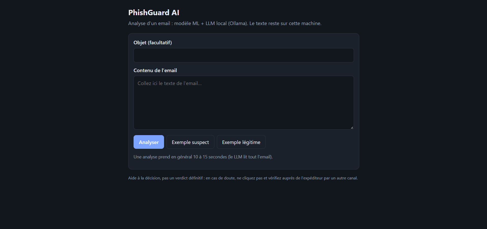

# PhishGuard AI : détection d'e-mails de phishing (ML + LLM local)

Détecteur d'e-mails de phishing en deux étages : un modèle ML classique (TF-IDF + régression logistique)
et un LLM local (Ollama, `qwen2.5:7b`). Le projet traite **uniquement les e-mails**. Il est livré avec une API
FastAPI et une petite interface web. Tout s'exécute en local : le texte des e-mails ne quitte pas la machine.

> Projet d'étude. C'est une aide à la décision, pas une passerelle de sécurité mail.



## Résultat principal

Évaluation sur un jeu **difficile** de 100 e-mails écrits à la main (40 `dev`, 60 `test`, classes équilibrées).
Le split `dev` a servi à choisir le modèle, le prompt et la règle de décision ; le split `test` a été lu
**une seule fois** (verrou `models/llm_test_done.lock`).

| Sur `test` (60 e-mails) | ML seul | LLM seul (`qwen2.5:7b`, zero-shot) |
|---|---|---|
| Recall | 0,800 [0,633 ; 0,933] | **0,967** [0,900 ; 1,000] |
| Faux positifs | 0,600 [0,433 ; 0,767] | **0,100** [0,000 ; 0,233] |
| Balanced accuracy | 0,600 | **0,933** |
| Erreurs | 24 | 4 |

Intervalles de confiance à 95 % par bootstrap. Avec 30 e-mails par classe, ils sont larges : l'écart avec le ML
est net, mais « 10 % de faux positifs » reste une estimation.

## Ce que montre ce projet

- **Évaluation honnête** : séparation `dev` / `test` stricte, `test` lu une seule fois, intervalles de confiance.
- **Une hypothèse abandonnée parce que les mesures la contredisent** : la cascade « ML puis LLM » a été
  écartée (voir plus bas) au profit du LLM seul.
- **Robustesse** : 4 cas d'injection de prompt testés, non-déterminisme du LLM mesuré et documenté.
- **Reproductibilité** : cache disque des réponses du LLM, configuration figée, test de parité entre notebook et code.
- **Dégradation maîtrisée** : si le LLM est indisponible, l'API répond avec le ML seul et le signale clairement.

## Démarrage rapide

Prérequis : Python 3.13 (testé), [Ollama](https://ollama.com), environ 5 Go de mémoire libre pour le modèle 7b
(téléchargement d'environ 4,7 Go).

```
git clone https://github.com/VOTRE-COMPTE/phishguard-ai.git
cd phishguard-ai
python -m venv .venv
.venv\Scripts\activate          # Linux/macOS : source .venv/bin/activate
pip install -r requirements.txt
ollama pull qwen2.5:7b
uvicorn src.api.main:app --host 127.0.0.1 --port 8000
```

Ouvrez ensuite http://127.0.0.1:8000. Une analyse prend en général 10 à 15 secondes ; la première peut être
plus longue, le temps que le modèle se charge en mémoire.

**Sans Ollama**, l'API et l'interface démarrent quand même, en mode dégradé : le verdict vient du ML seul et la
réponse porte un avertissement.

### API

- `POST /analyze` : `{"subject": "...", "body": "..."}` ou `{"text": "..."}`
- `GET /health` : état d'Ollama, du modèle et du cache
- `GET /docs` : documentation Swagger

```
curl -X POST http://127.0.0.1:8000/analyze -H "Content-Type: application/json" ^
  -d "{\"subject\": \"Verify your account\", \"body\": \"Confirm your login within 12 hours: http://example.test\"}"
```

(Le `^` de fin de ligne est la syntaxe de l'invite de commandes Windows ; sous Linux/macOS, utiliser `\`.)

Le champ `mode` de la réponse vaut `llm` (vérifié par le LLM), `ml_degrade` (ML seul, avec un champ
`avertissement`) ou `ml_seul`.

## Architecture

```
e-mail ──► ML (TF-IDF + LR) : toujours calculé, quelques ms
       └─► LLM (Ollama, qwen2.5:7b, JSON, température 0) : décide
               │
               ├─ réponse valide  ──► verdict du LLM            (mode "llm")
               └─ Ollama en panne / réponse illisible
                                   ──► verdict du ML, signalé    (mode "ml_degrade")
```

**Pourquoi « LLM seul » et pas une cascade** (le LLM n'étant appelé que dans la zone d'incertitude du ML) ?
Sur le jeu difficile, 11 des 24 erreurs du ML sont commises **avec assurance**, hors de la zone d'incertitude :
le LLM ne les voit jamais. Les règles en cascade plafonnent à 0,58-0,77 de balanced accuracy. Le ML garde trois
rôles : référence de comparaison, mode dégradé, et explication par mots pondérés.

Autres choix mesurés dans les notebooks : 4 prompts testés (zero-shot, grille de lecture, exemples, mini-RAG)
et 2 modèles. Le 3b est inutilisable en zero-shot (faux positifs 0,85 sur `dev`) ; les prompts changent peu les
résultats du 7b. Défense contre l'injection de prompt (balises `<email>`, consigne « donnée non fiable »,
neutralisation des balises) : 4 cas sur 4 résistés, mais ce sont 4 cas écrits à la main.

## Structure du dépôt

```
notebooks/   01 nettoyage · 02 split et EDA · 03 entraînement et évaluation ·
             04 évaluation sur jeu difficile · 05 cascade ML -> LLM
src/
  features/        features numériques d'e-mails (non utilisées par le modèle final)
  preprocessing/   split du jeu de données
  ml/              modèle ML figé
  llm/             client Ollama + cache, prompts, lecture de la réponse
  inference/       point d'entrée : EmailDetector.analyser(texte)
  api/             API FastAPI + page web intégrée
models/            modèle ML, vectorizer, configuration et prompts du LLM, résultats, cache LLM
data/hard/         mini_jeu_etendu.csv : 100 e-mails difficiles écrits à la main
tests/             tests unittest (sans Ollama)
scripts/           check_parity_dev.py : vérifie que src/ redonne les chiffres du notebook 05
```

## Tests et vérification

```
python -m unittest discover -s tests -t . -v
python scripts/check_parity_dev.py     # doit afficher PARITÉ OK (utilise models/llm_cache.jsonl)
```

Les tests de l'API nécessitent `fastapi` et `httpx` ; aucun test n'a besoin d'Ollama.

## Reproductibilité

- Le LLM n'est **pas déterministe** malgré température 0 et graine fixe : deux appels sans cache ont donné des
  sorties différentes. Les chiffres des notebooks ne se rejouent que grâce à `models/llm_cache.jsonl`.
- Ne modifiez pas `src/llm/prompts.py` sans refaire l'évaluation : un test vérifie qu'il reste identique à
  `models/llm_prompts.json`.
- Le split `test` du notebook 05 est consommé : toute nouvelle évaluation sérieuse demande de nouvelles données.

## Limites

- 100 e-mails écrits à la main, courts (moins de 310 caractères) et propres : les vrais e-mails sont plus longs
  et plus bruités ; les résultats ne sont pas garantis sur du trafic réel.
- Faux positifs fréquents sur les e-mails **légitimes** de réinitialisation de mot de passe et d'avis bancaires.
  Une fraude au président sans lien a aussi été manquée.
- Latence d'environ 13 s par e-mail avec le 7b ; Ollama traite les requêtes les unes après les autres.
- Pas d'authentification sur l'API : ne l'exposez pas sur un réseau sans proxy authentifié. Le contenu des
  e-mails n'est ni journalisé ni stocké.
- E-mails uniquement : pas de modèle d'URL, pas d'analyse des pièces jointes ni des en-têtes.

## Données

Versionnés : `data/hard/mini_jeu_etendu.csv` (100 e-mails écrits à la main) et `models/`. L'API, le notebook 05 et
les tests n'ont besoin que de ces deux éléments : ils fonctionnent après un simple clone.

**Non versionnés** (trop volumineux, licence propre à la source) : `data/raw/` et `data/processed/`.
Pour les reconstruire :

1. placer le corpus brut `phishing_email.csv` (environ 107 Mo) dans `data/raw/` ;
2. exécuter le notebook 01 (écrit `data/processed/emails_clean.csv`), puis le 02 (split, écrit
   `emails_test_raw.csv` et le vectorizer), puis 03 et 04.

<!-- Ajouter ici le nom et le lien du jeu de données source de phishing_email.csv. -->

Attention : les notebooks 02 et 03 **réécrivent** `models/emails_tfidf_vectorizer.joblib` et
`models/email_model.joblib`. Le notebook 05 et l'API dépendent de cette version exacte (colonnes retenues,
seuil, zone d'incertitude). Sauvegardez `models/` avant de les relancer, et refaites l'évaluation du notebook 05
si le modèle change.

Un jeu d'URL (`data/raw/URL_Dataset.csv`) existe dans le projet local mais n'est pas utilisé.

## Licence

Code publié sous licence MIT (voir [LICENSE](LICENSE)). Elle ne couvre ni le corpus d'entraînement ni les modèles
de langage, qui ont chacun leur propre licence (voir leurs sources, dont la page du modèle `qwen2.5` sur Ollama).

## Auteur

Projet réalisé par Wissal.
